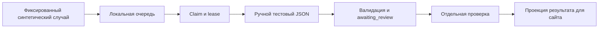

# Этап 03 — отдельный проект ChatGPT и локальный контракт моста

Актуальный статус 2026-09-06: [проект Sonnic](https://chatgpt.com/g/g-p-6a9c47e07510819197bd898c90d1b12b-sonnic-baza-znanii-i-razbor-snov/project) существует, переименован, закреплён и содержит сохранённые инструкции и **все 11 файлов** из manifest. Память ограничена проектом; это не изоляция клиентов внутри него. [Ручной синтетический тест blue-parrot](https://chatgpt.com/g/g-p-6a9c47e07510819197bd898c90d1b12b-sonnic-baza-znanii-i-razbor-snov/c/6a9d91ac-7f0c-83eb-a745-71c21114c9a8) выполнен: JSON прошёл схему и корреляцию, выдуманных событий не обнаружено. Ответ и оценка: `chatgpt-project/validation/`. Блокировки загрузки устранены. Автоматического транспорта на сайт пока нет. Secure MCP Tunnel требует runtime API key и не используется; альтернативный авторизованный HTTPS MCP ещё не реализован.

Решение владельца от 2026-09-06: Sonnic должен использовать отдельный проект ChatGPT с базой знаний. OpenAI API и существующий мост Codex ↔ Claude не заменяют этот путь. Адаптер этапа 02 сохранён как отложенная возможность; обязательного шага «получить API-ключ» больше нет.

## Готовый результат

- `chatgpt-project/`: инструкции, стиль, культурные ограничения, собственные заметки 12 источников, каталог, manifest SHA256, входная/выходная JSON Schema и семь синтетических сценариев, включая пару вход/выход «синий попугай».
- `apps/bridge/`: SQLite-очередь с owner/scope-проверками, идемпотентностью, lease, ограниченными retry, отменой и проверкой кандидата. Только фиксированные синтетические случаи. Обязательный отдельный review перед доступностью проекции результата для сайта.
- `scripts/build_chatgpt_package.py`: воспроизводимая сборка allowlist; `scripts/check_chatgpt_bridge.py`: локальный проход на вручную написанном ответе до `.cache/bridge-preview.json`.
- `tests/bridge/`: проверки владельцев, полномочий, сроков, корреляции, конфликтов, одновременных claim, перезапуска, отмены и проекции результата.

Исходный DOCX, основной demo-сайт и API-адаптер не менялись. Секреты/платные вызовы/публичный сервер не используются.

## Что именно работает

Стрелки выше проверяются локально. Живой ChatGPT, транспорт MCP и маршрут возврата в интерфейс сайта в эту цепочку ещё не подключены. Главный сайт остаётся demo. Тестовый review — проверка механики доставки, а не экспертиза ответа модели. Полный договор обмена: [BRIDGE_CONTRACT.md](../../chatgpt-project/BRIDGE_CONTRACT.md).

## Неподтверждённая внешняя часть

История прежней попытки (блок устранён): существование и наполнение проекта ещё не были подтверждены. Пользователь сообщил, что открыл свой ChatGPT. Новый штатный вызов `cua.getState` отклонён автоматической проверкой до чтения вкладок: лимит исчерпан. Ранее обычный Chrome был остановлен инструментом из-за невозможности достоверно определить URL. Обходов не выполнялось. Статус сохранён отдельно в [PROJECT_STATUS.json](../../chatgpt-project/PROJECT_STATUS.json), сборка пакета его не переписывает.

Подтверждённая документацией схема — ChatGPT вызывает доступные MCP-инструменты после запроса оператора. [Developer mode](https://developers.openai.com/api/docs/guides/developer-mode), [подключение MCP](https://developers.openai.com/plugins/deploy/connect-chatgpt), [проекты ChatGPT](https://learn.chatgpt.com/docs/projects). Совместимость инструментов с этим проектом/аккаунтом и путь подключения ещё требуют проверки. Автоматический запуск произвольного проекта из backend сайта не подтверждён. Реализованный UnconnectedProjectTransport сообщает об отсутствии подключения явно.

## Граница до личных снов

Synthetic-only — испытательный этап, а не выполнение конечной цели обработки пользовательских снов. Общая база знаний допустима, но личные данные разных клиентов не должны смешиваться в её памяти. Создание разных чатов не доказывает изоляцию. Нужно проверить раздельные пространства/память, учётные записи и серверное сопоставление владельцев, согласие на передачу, удаление и обработку ошибок. Пока не доказана изоляция во внешнем сервисе, код не принимает произвольные рассказы.

## Проверки и продолжение

Команды и актуальный журнал результатов — в [VALIDATION.md](../../chatgpt-project/VALIDATION.md). Автотесты доказывают локальный контракт; качество живого ChatGPT и retrieval ими не проверены. Браузерные тесты сайта/typecheck/build из этапа 02 не повторялись: UI-код в этом этапе не менялся.

Создание/переименование, сохранение инструкций, закрепление и загрузка 11 файлов завершены. Первый ручной синтетический тест прошёл; см. `chatgpt-project/validation/blue-parrot.review.md`. Следующий этап — отдельный авторизованный HTTPS MCP-транспорт и проверка pull-пути. Secure MCP Tunnel требует runtime API key и исключён при действующем условии. Переход к автоматическому реальному трафику и изоляция личных снов остаются открытыми задачами.
